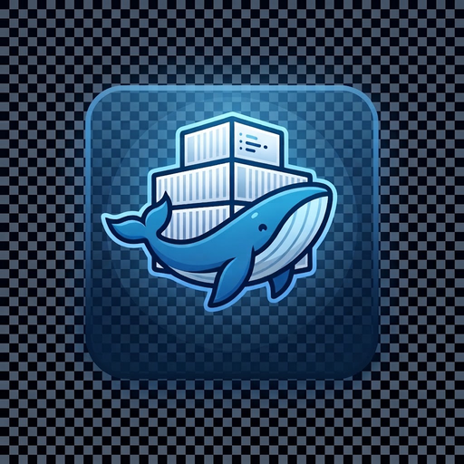

<div align="center">
  
  <h1>Docker Sandbox Manager</h1>
  <p>Gerencie seus projetos Docker Compose em um só lugar.</p>
</div>

O Docker Sandbox Manager é um aplicativo desktop para acompanhar projetos, serviços, containers, portas e recursos Docker. Escolha um workspace, encontre o que precisa e execute ações sem sair do painel.

## Navegação

- [Comece a usar](#comece-a-usar)
- [O que você pode fazer](#o-que-você-pode-fazer)
- [Como funcionam as ações](#como-funcionam-as-ações)
- [Requisitos e observações](#requisitos-e-observações)
- [Desenvolvimento](#desenvolvimento)

## Comece a usar

Você precisa ter o Docker instalado, o daemon acessível e o plugin Docker Compose v2 disponível no terminal como `docker compose`.

1. Abra o Docker Sandbox Manager.
2. No seletor **Contexto**, escolha o daemon Docker que deseja gerenciar.
3. Abra o menu da pasta e selecione um diretório pelo seletor nativo, escolha um dos **workspaces recentes** ou informe o caminho manualmente.
4. Clique em **Varrer diretório**. O app encontra projetos Compose dentro da pasta escolhida, incluindo pastas ocultas como `.devcontainer` (exceto `.git` e diretórios de build/dependências).
5. Expanda um projeto para ver seus serviços e começar a usar as ações.

Os oito workspaces mais recentes são lembrados localmente após uma varredura bem-sucedida. O app inicia na pasta pessoal do sistema ou, se existir, em `Projetos` dentro dela.

Em **Preferências**, escolha a IDE padrão para abrir projetos: Visual Studio Code, WebStorm, PhpStorm ou IntelliJ IDEA. O comando de inicialização da IDE precisa estar disponível no `PATH` do sistema.

## O que você pode fazer

### Acompanhar projetos e serviços

- Veja o resumo de projetos ativos, containers e portas publicadas.
- Pesquise por projeto, caminho, serviço ou imagem; filtre serviços ativos, parados ou com falhas.
- Favorite projetos e organize-os em grupos.
- Recolha projetos para simplificar a lista sem interromper o monitoramento.
- Acompanhe status e disponibilidade das portas, atualizados periodicamente.

### Controlar o Compose

- Inicie, pare ou reinicie serviços individualmente; também é possível iniciar ou parar um projeto ou os serviços selecionados.
- Use **Pull**, **Build** e **Recriar** quando precisar atualizar imagens ou containers.
- Salve presets de serviços para repetir combinações comuns.
- Consulte o mapa de dependências e escolha **Iniciar com dependências** quando necessário.
- Selecione perfis Compose e um arquivo `.env` por projeto. Os valores dos arquivos de ambiente nunca são exibidos no app.

### Consultar logs e métricas

- Abra logs sob demanda, pesquise linhas e filtre mensagens de erro.
- Exporte as linhas exibidas para um arquivo `.log` na pasta Downloads.
- Consulte CPU e memória por container, inclusive em serviços com réplicas, e acompanhe o histórico recente.
- Na tela de Projetos, ative a chave **Dashboard** na linha de cada serviço que deseja fixar. Só os serviços fixados recebem consultas de métricas; elas ocorrem em sequência, com intervalo mínimo de 10 segundos entre ciclos, enquanto o Dashboard está visível. Os logs só são iniciados quando solicitados.
- No Dashboard, reinicie ou remova os containers do serviço, abra logs e use o terminal interativo.
- Configure limites de CPU e memória para destacar valores altos.
- Copie endereços de portas ou abra portas TCP no navegador quando fizer sentido.

O Dashboard mantém a seleção por contexto Docker e projeto. A memória agregada é uma soma aproximada dos valores reportados pelo Docker; parar containers libera memória, enquanto pausá-los não.

### Usar ferramentas do serviço

- Abra um shell `sh` pelo ícone de terminal na linha do serviço em Projetos ou por **Mais ações** no Dashboard.
- No terminal, expanda **Comandos rápidos** abaixo do campo de comando para salvar, executar ou remover comandos. Eles são guardados por contexto, projeto e serviço.
- Consulte diagnósticos de configuração, containers órfãos e portas declaradas por mais de um serviço.
- Inspecione volumes e redes associados ao projeto. A remoção pede confirmação e só é permitida para recursos identificados como pertencentes ao projeto e sem containers associados.
- Ative notificações desktop para mudanças de saúde dos containers e alertas de recursos.

## Como funcionam as ações

| Ação | Comportamento |
|---|---|
| **Iniciar selecionados** | Inicia somente os serviços marcados, sem iniciar dependências automaticamente. |
| **Iniciar com dependências** | Inicia os serviços marcados e suas dependências declaradas no Compose. |
| **Parar selecionados** | Para os serviços marcados e mantém seus containers para uma próxima inicialização. |
| **Reiniciar serviço** | Reinicia os containers existentes do serviço, sem recriá-los. |
| **Remover containers** | Para e remove os containers do serviço; volumes não são removidos. |
| **Parar projeto** | Executa `docker compose down`: remove os containers e a rede padrão do projeto, mas não remove volumes. |
| **Pull / Build / Recriar** | Baixa imagens, constrói imagens ou recria containers, conforme a ação escolhida. |

Quando um serviço tem réplicas, as ações por serviço afetam todas as instâncias. As operações em andamento bloqueiam controles do mesmo projeto para evitar comandos concorrentes.

## Requisitos e observações

- **Docker e Compose:** o comando `docker` precisa estar disponível e o contexto selecionado deve conseguir acessar o daemon.
- **Saída JSON:** o app usa recursos do Docker Compose v2, incluindo `docker compose config --format json`.
- **Terminal:** o container precisa estar ativo e possuir `sh`. O painel oferece entrada e saída de texto, mas não é um terminal gráfico com pseudo-terminal. Os comandos rápidos são salvos localmente por contexto Docker, projeto e serviço.
- **Métricas e alertas:** o histórico de CPU e memória é local, limitado a 120 leituras por container e até 100 séries. Os alertas de recursos são enviados enquanto o painel de métricas está aberto.
- **Notificações:** é necessário ativá-las no app e permitir notificações nas configurações do sistema operacional.
- **Portas:** a verificação de disponibilidade é feita por TCP; portas UDP não são testadas dessa forma.
- **Dados locais:** favoritos, grupos, presets de serviços e comandos, serviços fixados no Dashboard, workspaces recentes, opções Compose e histórico de métricas ficam salvos localmente no dispositivo. O Docker Sandbox Manager executa os comandos no contexto Docker selecionado.

## Desenvolvimento

### Executar o aplicativo

Instale as dependências do projeto e inicie o app em modo de desenvolvimento:

```bash
npm install
npm run tauri dev
```

Após alterar código Rust, reinicie ou recompile o app Tauri para registrar os comandos atualizados.

### Verificações

```bash
npm run build
npm test
npm run test:browser
cargo test --manifest-path src-tauri/Cargo.toml --lib
```

Os testes de navegador usam Chromium e Docker simulado; não iniciam nem param containers reais. Se o navegador não estiver no caminho padrão, informe sua localização com `CHROME_BIN`.

## Tecnologias

Tauri · Rust · React · TypeScript · Docker Compose
